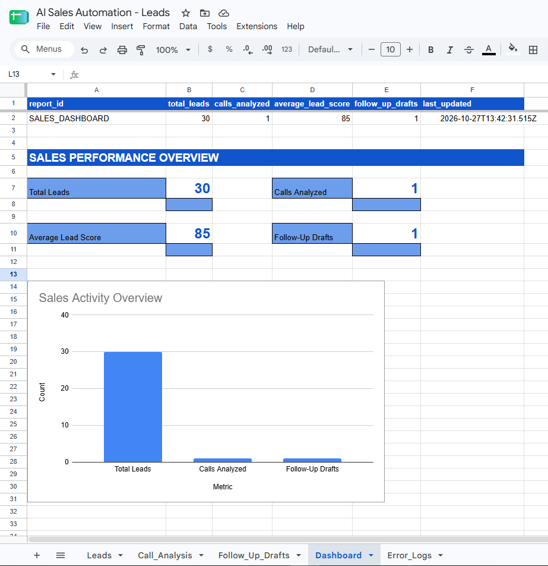
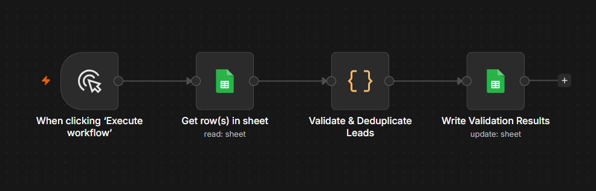
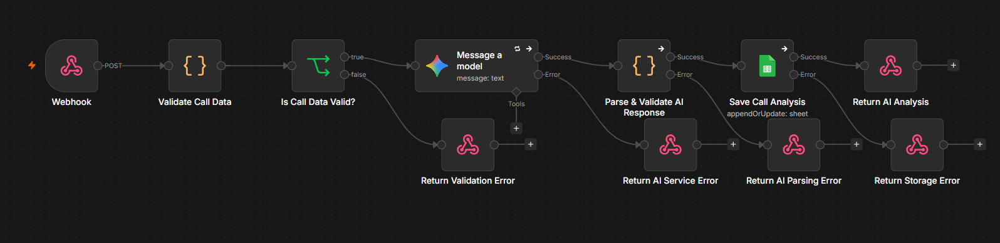
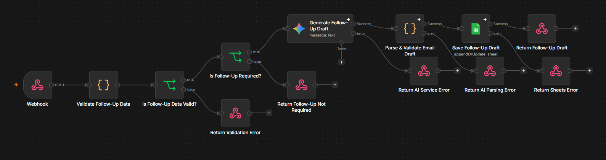
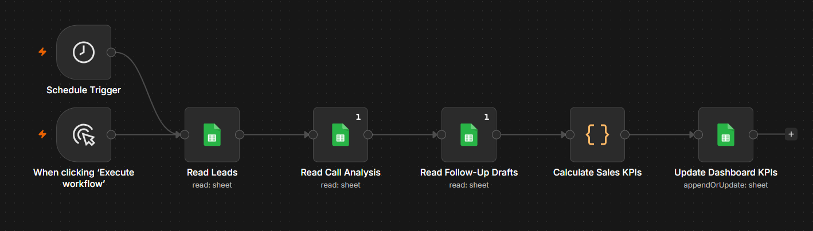
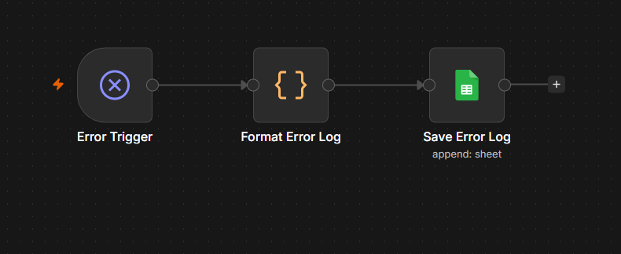

# AI Sales Automation System

**AI-powered B2B sales automation using n8n, Google Gemini, JavaScript, and Google Sheets.**

> **Status:** Five core modules implemented and tested with synthetic data | Portfolio Project


## Watch the Demo

🎬 **[Watch the AI Sales Automation System Demo](https://github.com/iziga1/ai-sales-automation-system/releases/tag/v1.0.0-demo)**

The demo showcases AI-powered sales call analysis, personalized follow-up email drafts, and automated sales dashboard updates using synthetic B2B data.

**Tech stack:** n8n · Google Gemini · Google Sheets · JavaScript · PowerShell


## Overview

AI Sales Automation System is a modular automation project designed to demonstrate how AI and workflow automation can streamline B2B sales operations.

The system uses synthetic German-market sales data to demonstrate lead validation, AI-powered call analysis, personalized follow-up email drafting, sales performance reporting, and centralized error monitoring.

The project focuses on practical workflow orchestration, structured AI outputs, data validation, API integrations, and operational reliability.


## Project Screenshots

### Sales Performance Dashboard



### Automation Workflows

**01 — Lead Validation**



**02 — AI Call Analysis**



**03 — Automated Follow-Up**



**04 — Sales Automation Dashboard**



**05 — Error Handling & Monitoring**




## Business Problem

B2B sales teams spend significant time on repetitive administrative tasks:

- Cleaning and validating lead databases
- Identifying duplicate customer records
- Reviewing sales call transcripts
- Identifying customer interest and next steps
- Preparing personalized follow-up emails
- Monitoring sales activity and workflow failures

Manual processes can increase operational costs, delay follow-ups, and introduce data inconsistencies.

## Solution Architecture

The system consists of five n8n workflow modules.

```text
              Google Sheets
                   |
                   v
          01 - Lead Validation
                   |
                   v
              Leads Data

       Simulated Sales Transcript
                   |
                   v
          02 - AI Call Analysis
                   |
                   v
             Google Gemini
                   |
                   v
             Call_Analysis
                   |
                   v
        03 - Automated Follow-Up
                   |
                   v
             Google Gemini
                   |
                   v
            Follow_Up_Drafts


   Leads + Call_Analysis + Follow_Up_Drafts
                   |
                   v
       04 - Sales Automation Dashboard
                   |
                   v
          Google Sheets Dashboard


        Failed Workflow Executions
                   |
                   v
       05 - Error Handling & Monitoring
                   |
                   v
          Google Sheets Error_Logs
```

The modules use shared Google Sheets data, webhooks, and n8n workflow configuration. The diagram represents their logical relationships, not a single continuously executing workflow.

## Technology Stack

| Technology | Purpose |
|---|---|
| n8n | Workflow orchestration and automation |
| Google Gemini API | AI call analysis and follow-up email generation |
| JavaScript | Data validation, transformation, and KPI calculations |
| Google Sheets | Lead storage, AI outputs, reporting, and error logs |
| Webhooks / HTTP | Triggering and integrating automation workflows |
| Docker | Local n8n environment |
| Git and GitHub | Version control, documentation, and portfolio presentation |

## Implemented Modules

### 01 — Lead Validation

Validates and processes synthetic B2B lead records.

Key capabilities:

- Lead data validation
- Duplicate detection
- Structured lead processing
- Google Sheets integration

**Test dataset:** 30 synthetic leads.

Documentation: [Lead Validation](docs/lead-management.md)

### 02 — AI Call Analysis

Analyzes simulated sales call transcripts using Google Gemini.

Key capabilities:

- Webhook-based input
- AI-powered transcript analysis
- Structured JSON output
- Lead scoring
- Storage in Google Sheets

**Verified test:** One call analysis with a lead score of 85.

Documentation: [AI Call Analysis](docs/ai-call-analysis.md)

### 03 — Automated Follow-Up

Generates personalized German-language B2B follow-up email drafts.

Key capabilities:

- Webhook-based workflow
- Follow-up decision logic
- Google Gemini email generation
- Structured subject and body output
- Google Sheets draft storage
- Error response handling

Emails are stored as drafts for human review. The workflow does not automatically send emails.

**Verified test:** One follow-up draft saved successfully.

Documentation: [Automated Follow-Up](docs/automated-follow-up.md)

### 04 — Sales Automation Dashboard

Consolidates data from the previous modules into a Google Sheets reporting dashboard.

Tracked KPIs:

- Total Leads
- Calls Analyzed
- Average Lead Score
- Follow-Up Drafts
- Last Updated

The dashboard includes KPI cards and a dynamic activity chart.

The workflow supports manual execution and is configured for daily scheduled execution at 08:00 (Europe/Sarajevo).

**Verified test results:**

| KPI | Value |
|---|---:|
| Total Leads | 30 |
| Calls Analyzed | 1 |
| Average Lead Score | 85 |
| Follow-Up Drafts | 1 |

Documentation: [Sales Automation Dashboard](docs/sales-automation-dashboard.md)

### 05 — Error Handling & Monitoring

Provides centralized error logging for the automation system.

Key capabilities:

- n8n Error Trigger
- Structured error processing
- Workflow and execution identification
- Error message and node tracking
- UTC timestamps
- Google Sheets error logging

All four operational modules are configured to use the central error workflow.

**Verified test:** An intentionally failed scheduled workflow generated a new record in `Error_Logs`.

Documentation: [Error Handling & Monitoring](docs/error-handling-monitoring.md)

## Project Structure

```text
ai-sales-automation-system/
├── data/
├── docs/
├── screenshots/
├── scripts/
├── workflows/
├── .env.example
├── .gitignore
├── LICENSE
└── README.md
```

The `workflows/` directory contains sanitized n8n workflow exports. The `docs/` directory contains technical documentation for individual modules.

## Setup

1. Install and run n8n.
2. Import the workflow JSON files from `workflows/`.
3. Configure Google Sheets OAuth credentials.
4. Configure Google Gemini API credentials where required.
5. Create the required Google Sheets worksheets.
6. Update spreadsheet selections and workflow-specific settings.
7. Configure the Error Workflow setting for monitored workflows.
8. Test each module using synthetic data before enabling scheduled execution.

Public workflow exports intentionally exclude private spreadsheet identifiers and credential references.

## Testing and Validation

The system has been tested locally using synthetic B2B sales data.

Verified functionality includes:

- Lead validation and duplicate handling
- AI call analysis and structured output storage
- AI-generated follow-up draft storage
- Dashboard KPI calculation and updates
- Centralized logging of an intentionally triggered workflow error

Testing is based on demonstration scenarios and does not represent production-scale performance.

## Security and Privacy

- Synthetic customer and sales data are used for demonstrations.
- API keys and credentials are excluded from version control.
- Public workflow exports are sanitized.
- Generated follow-up emails are stored for human review rather than automatically sent.
- Error logs may contain operational details and should be reviewed before use with sensitive production data.

## Current Limitations

- No live CRM integration is implemented.
- No automatic email sending is enabled.
- The dashboard currently uses a small demonstration dataset.
- Scheduled execution requires a running n8n instance.
- The central error logger depends on Google Sheets availability.
- Production deployment, comprehensive automated testing, and alert notifications are not yet implemented.

## Development Roadmap

- [x] Initialize GitHub repository
- [x] Configure project structure and Git
- [x] Implement lead validation
- [x] Implement AI call analysis with Google Gemini
- [x] Implement automated follow-up drafting
- [x] Create sales automation dashboard
- [x] Implement centralized error handling and monitoring
- [ ] Add architecture diagrams and demo screenshots
- [ ] Publish a complete end-to-end demonstration
- [ ] Evaluate CRM integration
- [ ] Add automated alerts and retry strategies
- [ ] Prepare production deployment documentation

## Project Scope

This is an independent portfolio project demonstrating AI-powered workflow automation, data processing, and system integration skills.

It is not a production CRM platform.

## License

MIT License.
