# System Architecture

> **Status:** Proposed architecture (v1) — implementation in progress.  
> **Project:** AI Sales Automation System  
> **Scope:** Portfolio demonstration using synthetic leads and simulated call events.

## 1. Purpose and Scope

AI Sales Automation System is a modular, event-driven demonstration of B2B sales operations automation. **n8n** orchestrates lead validation, simulated call analysis, CRM updates, email drafting, follow-up tasks, and reporting.

The project is not an official Advista system. Initially, it does **not** place real calls or send outbound emails automatically. Integrations may use sandboxes or mocks until credentials and test accounts are available.

### Design goals

- Separate AI interpretation from deterministic business actions.
- Make repeated event delivery safe through idempotency checks.
- Validate data before it reaches external systems.
- Record outcomes and failures without exposing credentials or unnecessary personal data.
- Keep each workflow independently testable.

## 2. Architecture Overview

```mermaid
flowchart TD
    A[Google Sheets / CSV] --> B[n8n Lead Validation]
    B --> C[(Validated Lead Records)]

    D[Simulated Call Webhook] --> E[Payload Validation]
    E --> F{Event Already Processed?}
    F -->|Yes| X[Return Existing Result]
    F -->|No| G[Load Matching Lead]
    C --> G
    G --> H[OpenAI Transcript Analysis]
    H --> I[Schema and Business Validation]
    I --> J{Valid and Unambiguous?}
    J -->|No| K[Manual Review Queue]
    J -->|Yes| L[Business Rules]

    L --> M[CRM Contact / Status Upsert]
    L --> N{Email Requested?}
    L --> O{Callback Requested?}
    N -->|Yes| P[Gmail Draft]
    O -->|Yes| Q[CRM Follow-up Task]

    M --> R[Outcome Log]
    P --> R
    Q --> R
    K --> R
    R --> S[(Reporting Data)]
    S --> T[Dashboard]

    E -.-> U[Error Handler]
    G -.-> U
    H -.-> U
    I -.-> U
    M -.-> U
    P -.-> U
    Q -.-> U
    U --> V[Error Log and Alerts]
```



**Diagram conventions:** Solid arrows show the intended processing path. Dashed arrows represent planned error-handling paths, **not** automatically configured n8n error outputs. Some operations may execute independently or in sequence according to their dependencies. All required outcomes are recorded before an event is marked complete.

**Important:** `Email Requested?` and `Callback Requested?` are independent conditions. A single call can update the CRM, create an email draft, **and** schedule a callback. An uninterested lead still receives an appropriate CRM status update; a draft or callback is created only if business rules permit it.

## 3. System Components

| Component | Technology | Responsibility |
|---|---|---|
| Lead source | Google Sheets / CSV | Store synthetic leads and validation results |
| Workflow orchestration | n8n | Triggers, routing, integration calls, and execution control |
| Data transformation | JavaScript in n8n | Normalize, validate, and deduplicate records |
| AI interpretation | OpenAI API | Analyze simulated German-language call transcripts |
| CRM adapter | Pipedrive API or mock | Upsert contacts, statuses, deals, and activities |
| Communication | Gmail API | Create reviewable follow-up drafts |
| Reporting | Google Sheets / Looker Studio | Summarize outcomes and operational KPIs |
| Monitoring | n8n logs and error workflow | Track failures and alert an operator |

### 3.1 Data Layer

The initial source of truth for sample leads is Google Sheets. Each lead has a stable `lead_id`; email addresses are normalized for comparison, but email alone is not treated as a guaranteed globally unique identifier. Validation results are written back to the source.

Processed event IDs and action outcomes must be stored in a **persistent event ledger** (for the MVP, a dedicated Google Sheet can serve this purpose). This is a demonstration-level solution, not a concurrency-safe transactional database. A production system would use durable storage with unique constraints and atomic updates.

### 3.2 Automation Layer

n8n controls workflow execution and calls external services. It validates webhook input, checks processing state, invokes AI, evaluates rules, and performs authorized business actions. AI-generated text never directly executes arbitrary API operations.

### 3.3 AI Processing Layer

OpenAI receives a validated transcript and a constrained prompt. It returns structured analysis, including customer interest, summary, requested actions, and possible callback details. The response is checked against an explicit schema and business rules. Missing, contradictory, or uncertain information is routed for manual review rather than guessed.

### 3.4 CRM Layer

The CRM adapter searches by a stored external identifier before creating a contact. It updates the status based on the validated call outcome and creates follow-up activities when appropriate. For interested leads, a deal may be created or updated according to defined pipeline rules. A mock adapter can be used before Pipedrive is connected.

### 3.5 Email Layer

The email workflow drafts German-language follow-up messages based on approved lead details and the validated call summary. It checks for an available recipient address and creates a **draft only**. A human reviews the content before sending. The MVP does not automatically send email.

### 3.6 Reporting Layer

A reporting dataset collects lead validation outcomes, call classifications, CRM actions, draft creation, callback tasks, and execution errors. Dashboard figures distinguish simulated outcomes from actual connected-service operations.

## 4. Planned Workflows

### WF-01 — Lead Validation

**Trigger:** Manual execution initially; scheduled execution is optional later.

1. Read lead rows from Google Sheets.
2. Normalize whitespace, company names, and email addresses.
3. Validate required fields and basic email syntax.
4. Identify duplicates using normalized contact identifiers and documented matching rules.
5. Assign a result such as `valid`, `invalid`, or `duplicate`.
6. Update the original row using a stable row reference or `lead_id` lookup.
7. Record processing time and any validation reasons.

**Success condition:** Every input row has a deterministic validation outcome, and rerunning the workflow does not generate extra leads.

### WF-02 — AI Call Analysis

**Trigger:** Authenticated simulated-call webhook.

1. Validate the payload and required fields.
2. Check `event_id` against the persistent event ledger.
3. Find the corresponding validated lead.
4. Send the transcript to OpenAI.
5. Validate the returned JSON and allowed values.
6. Route ambiguous or incomplete results for review.
7. Store validated analysis and initiate downstream actions.

**Success condition:** A valid new event produces one recorded analysis; duplicate delivery does not repeat completed business actions.

### WF-03 — CRM Synchronization

**Trigger:** Validated analysis event.

1. Find the CRM contact using a stable external identifier.
2. Create or update the contact without duplicating it.
3. Update lead status and record the call outcome.
4. Create or update a deal only when the pipeline rules require it.
5. Record CRM object identifiers and action results.

**Success condition:** Reprocessing the same event does not create duplicate contacts, deals, or notes.

### WF-04 — Email Draft and Callback

**Trigger:** Validated analysis with one or both requested actions.

1. Evaluate `email_requested` and `callback_requested` **independently**.
2. If email is requested and an address is available, generate and save a Gmail draft.
3. If a callback is requested, resolve the date and timezone; send ambiguous dates to manual review.
4. Create a CRM follow-up activity for a confirmed callback.
5. Record each action separately, including skipped and failed actions.

**Success condition:** A call requesting both actions can produce both a draft and a task, without duplicate side effects.

### WF-05 — Reporting and Monitoring

**Trigger:** Manual or scheduled execution.

1. Read lead, event, and action records.
2. Calculate KPIs from documented definitions.
3. Update reporting tables and dashboard sources.
4. Summarize failed or pending operations.

**Success condition:** Metrics are reproducible from stored records and do not double-count duplicate events.

## 5. Data Contracts

The detailed schema will be maintained in [`data-model.md`](data-model.md).

### 5.1 Example Incoming Call Event

```json
{
  "event_id": "evt-0001",
  "call_id": "call-0001",
  "lead_id": "L001",
  "timestamp": "2026-10-15T10:00:00+02:00",
  "language": "de",
  "transcript": "Bitte senden Sie mir Informationen per E-Mail."
}
```

### 5.2 Example AI Analysis Result

```json
{
  "interest_level": "interested",
  "summary": "The contact requested additional information by email.",
  "email_requested": true,
  "callback_requested": false,
  "callback_datetime": null,
  "next_action": "prepare_email_draft",
  "requires_review": false
}
```

Allowed values, required fields, nullability, and validation rules will be specified in the data model. `callback_datetime` must be an unambiguous ISO 8601 timestamp with an offset when a callback is confirmed. Relative expressions such as “next Tuesday” must be resolved using the call timestamp and relevant timezone; otherwise, manual review is required.

## 6. Business Rules

1. **Invalid lead:** Do not perform CRM or communication actions until the lead passes validation.
2. **Duplicate event:** Return or reuse the recorded outcome; do not repeat completed side effects.
3. **Valid call analysis:** Update the CRM contact and call status, including `not_interested` when applicable.
4. **Email requested:** Create a draft only when an eligible recipient and adequate context are available.
5. **Callback requested:** Create an activity only when the callback time is sufficiently clear.
6. **Both requested:** Perform both eligible actions independently.
7. **Uncertain analysis:** Queue for human review and block uncertain downstream actions.
8. **Partial failure:** Record the successful steps and retry only incomplete, retry-safe steps.

## 7. Reliability, Idempotency, and Errors

### 7.1 Event Ledger

Store at least `event_id`, `lead_id`, processing status, timestamps, and action-level results. Suggested statuses: `received`, `processing`, `needs_review`, `completed`, and `failed`.

`event_id` identifies the incoming event; each downstream action should also have a stable key such as `event_id + action_type` to prevent duplicate drafts or tasks. A simple Google Sheets ledger is acceptable for sequential demo testing, but **does not guarantee exactly-once processing under concurrent requests**.

### 7.2 Retry Strategy

Retry transient failures such as timeouts or HTTP 429/5xx with bounded attempts and backoff. Do not blindly retry validation errors (for example, HTTP 400) or non-idempotent creation operations without checking whether the previous attempt succeeded.

### 7.3 Error Logging

Capture workflow name, event ID, stage, timestamp, error category, and retry status. Avoid storing credentials or full sensitive payloads in logs. Configure n8n error workflows or explicit failure branches where supported.

### 7.4 Manual Review

Queue events when AI output is invalid, customer intent is contradictory, a callback time is unclear, or required data is missing. Record the review decision before resuming blocked actions.

## 8. Security and Privacy

- Use only synthetic lead and transcript data in the public portfolio repository.
- Store API secrets in n8n credentials or protected environment variables, never in committed files.
- Restrict webhook access and validate authentication or signatures where supported.
- Apply least-privilege access to Google, CRM, and email integrations.
- Do not automatically send outbound messages in the MVP.
- Review exported n8n JSON files for secrets, tokens, personal data, and sensitive URLs before committing.
- Avoid logging full transcripts unless necessary; define retention and deletion rules before using real personal data.
- Assess applicable privacy and direct-marketing requirements before any real outreach.

## 9. Development and Deployment

### Local / Test Environment

- GitHub for source control and pull requests
- VS Code for documentation and scripts
- n8n Cloud trial or self-hosted n8n
- Google Sheets containing synthetic leads
- OpenAI API with controlled test inputs
- Mock CRM adapter or Pipedrive test account
- Gmail draft integration using a dedicated test account

### Release Process

1. Develop each feature on its own branch.
2. Test with synthetic success, failure, and duplicate-event cases.
3. Review exported workflows and changed configuration files.
4. Open a pull request with evidence of tests.
5. Merge validated changes into `main`.

### Portfolio Demonstration

The final demo will process a sample lead and simulated call event, display the AI analysis, show permitted CRM and draft/callback outcomes, and demonstrate duplicate-event and failure handling.

## 10. Architectural Decisions and Limitations

| Decision | Rationale / limitation |
|---|---|
| n8n as orchestrator | Centralized integration logic and visual debugging |
| OpenAI for interpretation only | Business actions remain deterministic and validated |
| Independent email and callback conditions | Multiple outcomes can arise from one call |
| Google Sheets for MVP | Easy to inspect, but not transactional under concurrency |
| Draft-only email flow | Prevents accidental outbound communication |
| Synthetic calls and leads | Safe, repeatable portfolio demonstrations |
| Manual review for ambiguity | Avoids fabricated dates or unsupported actions |

## 11. Implementation Status

**This document is a design specification, not proof of implementation.** Current feature completion is tracked in the root [`README.md`](../README.md) and will be detailed in [`development-plan.md`](development-plan.md).

The next implementation milestone is **WF-01 — Lead Validation**.