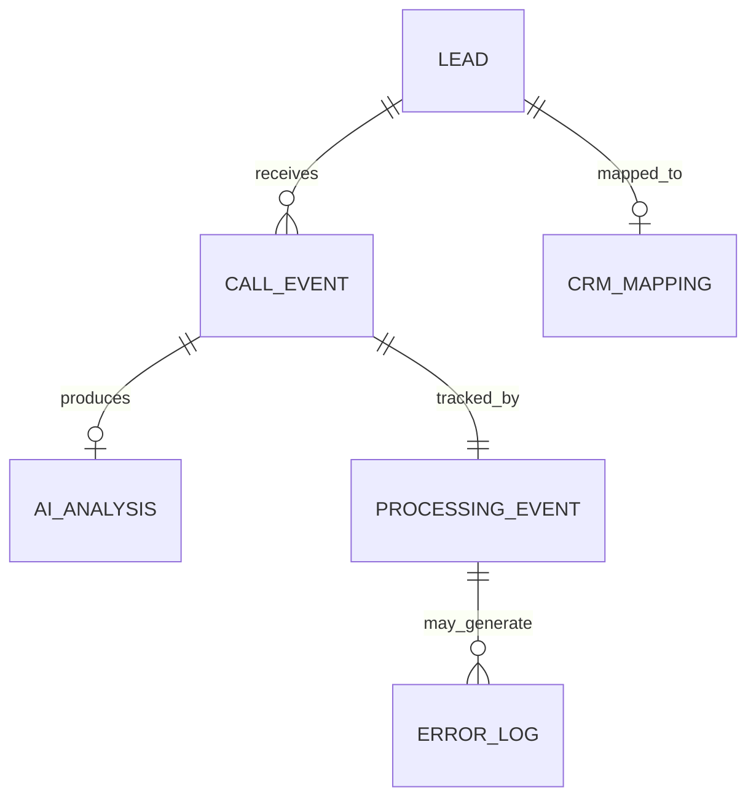

# Data Model and Integration Contracts

**Project:** AI Sales Automation System  
**Status:** Proposed v1 — implementation pending  
**Data policy:** Synthetic demonstration data only

## 1. Purpose

This document defines the canonical records exchanged between Google Sheets, n8n, OpenAI, and the CRM adapter. The models are implementation targets, not claims that integrations are already operational.

## 2. Conventions

- Identifiers are stable strings and must not be generated from row numbers.
- Timestamps use ISO 8601 with a timezone offset; persist UTC where possible.
- Required strings must be non-empty after trimming.
- Email addresses are trimmed and normalized to lowercase for matching; format validation is not deliverability verification.
- Phone numbers are normalized to E.164 where feasible, but no phone number is required for the initial lead-validation MVP.
- `null` represents an unknown or unavailable value; it is different from `false`.
- All records in the repository use fictional organizations and reserved `.example` email domains.

## 3. Lead

The lead is the canonical contact record. The first implementation stores it in a Google Sheets tab named `Leads`.

| Field | Type | Required | Description |
|---|---|---|---|
| `lead_id` | string | Yes | Unique immutable identifier, e.g. `L001` |
| `company_name` | string | Yes | Company name |
| `contact_name` | string | No | Contact person |
| `email` | string | Yes | Contact email |
| `phone` | string or null | No | Phone number |
| `country` | string | No | Country name or ISO country code (choose one convention for each dataset) |
| `industry` | string | No | Industry category |
| `status` | enum | Yes | `new`, `valid`, `invalid`, `duplicate`, `review` |
| `validation_result` | string or null | No | Machine-readable reason, e.g. `invalid_email` |
| `processed_at` | ISO datetime or null | No | Last validation timestamp |

Example:

```json
{
  "lead_id": "L001",
  "company_name": "Muster GmbH",
  "contact_name": "Anna Beispiel",
  "email": "anna@muster.example",
  "phone": "+49301234567",
  "country": "DE",
  "industry": "Manufacturing",
  "status": "valid",
  "validation_result": null,
  "processed_at": "2026-10-15T16:00:00Z"
}
```

### 3.1 Lead validation and duplicates

For the MVP, require `lead_id`, `company_name`, and `email`. Validate basic email syntax and detect duplicates by normalized email within the dataset. If email is missing or invalid, mark the record `invalid`; if another earlier valid row has the same normalized email, mark the later row `duplicate`. Duplicate detection across different data sources will be a later enhancement. Do not overwrite a valid row with a duplicate row.

## 4. Call Event (Webhook Input)

A call event is a simulated inbound webhook message. It is independent of the lead-import workflow.

| Field | Type | Required | Description |
|---|---|---|---|
| `event_id` | string | Yes | Unique event idempotency key |
| `call_id` | string | Yes | Identifier of the simulated call |
| `lead_id` | string | Yes | References an existing lead |
| `timestamp` | ISO datetime | Yes | When the call occurred |
| `language` | string | Yes | BCP 47 language tag, e.g. `de-DE` |
| `transcript` | string | Yes | Simulated call transcript |

```json
{
  "event_id": "evt-0001",
  "call_id": "call-0001",
  "lead_id": "L001",
  "timestamp": "2026-10-15T14:00:00Z",
  "language": "de-DE",
  "transcript": "Bitte senden Sie mir weitere Informationen per E-Mail. Rufen Sie mich am Dienstag um 10 Uhr wieder an."
}
```

### 4.1 Webhook validation

Reject payloads with missing required fields, invalid timestamps, unknown `lead_id`, or empty transcripts. Authentication and request-size limits must be configured before exposing a production webhook.

## 5. AI Call Analysis (Structured Output)

OpenAI extracts information but does not directly modify CRM records or send email. The response is schema-validated before any business action.

| Field | Type | Required | Allowed values / notes |
|---|---|---|---|
| `interest_level` | enum | Yes | `interested`, `not_interested`, `unclear` |
| `summary` | string | Yes | Short neutral summary |
| `email_requested` | boolean | Yes | Explicit request for an email |
| `callback_requested` | boolean | Yes | Explicit request for a callback |
| `callback_datetime` | ISO datetime or null | Yes | Resolved time only when unambiguous |
| `next_action` | enum | Yes | `follow_up`, `send_info`, `close`, `review`, `none` |
| `requires_review` | boolean | Yes | Human intervention required |

```json
{
  "interest_level": "interested",
  "summary": "Prospect requested additional information and a callback.",
  "email_requested": true,
  "callback_requested": true,
  "callback_datetime": null,
  "next_action": "review",
  "requires_review": true
}
```

The example deliberately leaves `callback_datetime` null: the phrase “Tuesday at 10” lacks a confirmed timezone and could require clarification. Do not invent a precise date or timezone. Business rules must independently evaluate `email_requested` and `callback_requested`; they are not mutually exclusive.

## 6. CRM Mapping

Keep external CRM identifiers separate from internal lead identifiers.

| Field | Type | Required | Description |
|---|---|---|---|
| `lead_id` | string | Yes | Internal lead ID |
| `crm_person_id` | string or null | No | Pipedrive person identifier |
| `crm_org_id` | string or null | No | Pipedrive organization identifier |
| `crm_deal_id` | string or null | No | Pipedrive deal identifier |
| `last_synced_at` | ISO datetime or null | No | Last successful sync |
| `sync_status` | enum | Yes | `pending`, `synced`, `failed`, `review` |

For the MVP, a mock CRM adapter may store this mapping. When using Pipedrive, first search by a stable mapping key; do not assume that company names are unique.

## 7. Processing Event (Idempotency Ledger)

Track every incoming `event_id` in persistent storage, with a uniqueness constraint where supported.

| Field | Type | Required | Description |
|---|---|---|---|
| `event_id` | string | Yes | Unique event identifier |
| `call_id` | string | Yes | Associated call |
| `lead_id` | string | Yes | Associated lead |
| `processing_status` | enum | Yes | `received`, `processing`, `completed`, `failed`, `review` |
| `attempt_count` | integer | Yes | Number of processing attempts, initially 0 |
| `received_at` | ISO datetime | Yes | First receipt timestamp |
| `completed_at` | ISO datetime or null | No | Completion timestamp |
| `last_error_code` | string or null | No | Latest failure reason |

A read-then-write check in Google Sheets is insufficient to guarantee concurrency-safe deduplication. Production-grade idempotency requires atomic uniqueness enforcement (e.g. a database unique index) and action-level deduplication for CRM activities and email drafts. The portfolio MVP can demonstrate sequential replay protection and document this limitation.

## 8. Error Log

| Field | Type | Required | Description |
|---|---|---|---|
| `error_id` | string | Yes | Unique log record identifier |
| `event_id` | string or null | No | Related event, if any |
| `workflow_name` | string | Yes | Source workflow |
| `step_name` | string | Yes | Failing step |
| `error_code` | string | Yes | Stable machine-readable error code |
| `message` | string | Yes | Sanitized human-readable summary |
| `retryable` | boolean | Yes | Whether retry may succeed |
| `occurred_at` | ISO datetime | Yes | Error timestamp |

Do not log API tokens, raw credentials, or unnecessary personal data.

## 9. Relationships



`AI_ANALYSIS` is logically associated with one call event. If re-analysis versions are retained later, the relationship and versioning rules will be updated.

## 10. Data Storage and Retention

- **Google Sheets:** initial `Leads` table and demo reporting records.
- **n8n:** workflow orchestration and credentials (credentials are never exported to Git).
- **Persistent event ledger:** mock storage for MVP; database-backed unique keys for robust concurrent execution.
- **CRM:** external customer records and activities, initially mocked if necessary.
- **GitHub:** synthetic sample datasets, schemas, scripts, and workflow definitions only.

Define an explicit retention and deletion policy before processing real customer data.

## 11. Test Cases Derived from the Model

| ID | Input | Expected result |
|---|---|---|
| DM-01 | Valid lead | `status=valid` |
| DM-02 | Invalid email | `status=invalid`, `validation_result=invalid_email` |
| DM-03 | Duplicate normalized email | Later record marked `duplicate` |
| DM-04 | Missing `event_id` | Webhook rejected |
| DM-05 | Replayed completed `event_id` | No repeated downstream actions |
| DM-06 | AI output missing required field | Validation fails; review or error handling |
| DM-07 | Email and callback both requested | Both eligible actions evaluated |
| DM-08 | Ambiguous callback date | `callback_datetime=null`, `requires_review=true` |

## 12. Versioning

This document defines **contract version 1**. Any breaking changes to field names, types, or enum values must be documented and reflected in test fixtures, workflow logic, and the README roadmap.
